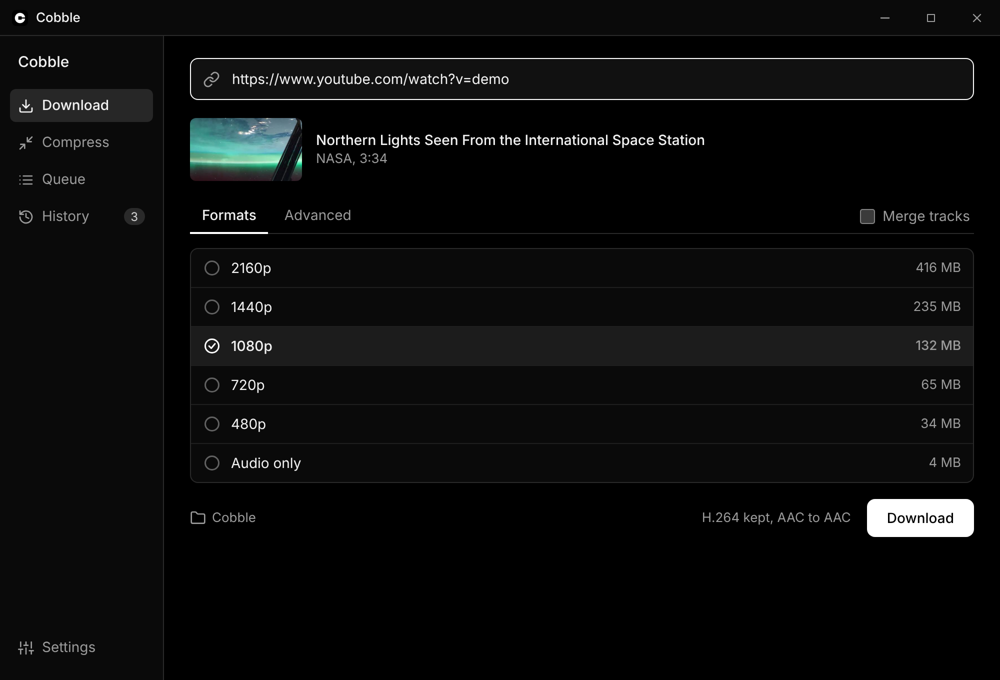
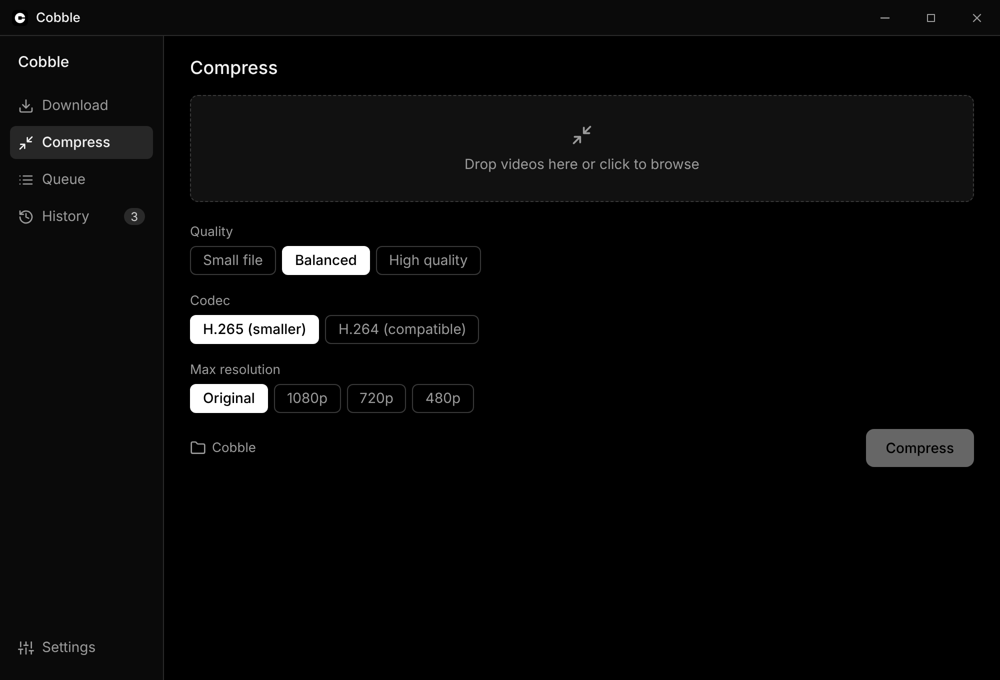
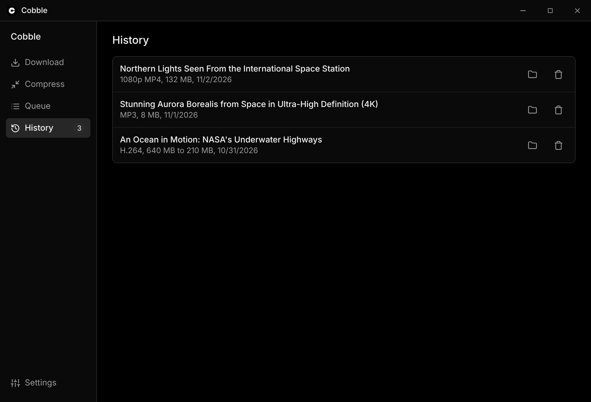

<p align="center">
  
</p>

<h1 align="center">Cobble</h1>

<p align="center">
  Download video and audio, and convert it so it opens in your editor.<br>
  A Windows app built on yt-dlp and ffmpeg.
</p>

<p align="center">
  <a href="https://cobbleapp.ca/download"><b>Download</b></a> ·
  <a href="https://cobbleapp.ca">Website</a> ·
  <a href="https://cobbleapp.ca/faq">FAQ</a> ·
  <a href="https://cobbleapp.ca/changelog">Changelog</a>
</p>

<p align="center">
  
</p>

## Why Cobble

Downloaded video often won't import into After Effects or Premiere: VP9, Opus, odd containers. Cobble fetches it and converts it to something your editor opens, in one step.

## Features

- **Every quality, with file size.** Pick a resolution, or merge a video and audio track you choose.
- **Editor-ready presets.** After Effects ready (H.264 MP4), ProRes 422, Keep original, MP3.
- **No needless re-encoding.** Tracks that already match the preset are copied, not converted.
- **Compress local files.** Shrink video already on your PC to H.264 or H.265.
- **Playlists and a queue.** Download whole playlists, track jobs, and find finished files in History.
- **Self-contained.** yt-dlp, ffmpeg and Deno are bundled. No account, no setup.

## Screenshots

| Compress | History |
| --- | --- |
|  |  |

## Credits

Screenshots use NASA footage, which is generally not subject to copyright ([NASA media usage guidelines](https://www.nasa.gov/nasa-brand-center/images-and-media/)). NASA does not endorse Cobble.

- [Northern Lights Seen From the International Space Station](https://www.youtube.com/watch?v=mjnGe-zLhcM), NASA
- [Stunning Aurora Borealis from Space in Ultra-High Definition (4K)](https://www.youtube.com/watch?v=PBJAR3-UvSQ), NASA
- [An Ocean in Motion: NASA's Mesmerizing View of Earth's Underwater Highways](https://www.youtube.com/watch?v=R5-s6O8qyvE), NASA Goddard

File sizes and formats in the screenshots are illustrative.

## Install

1. Download the installer from [cobbleapp.ca/download](https://cobbleapp.ca/download).
2. Run it. Windows 64-bit only.

The installer is not yet code signed, so Windows SmartScreen shows an unknown publisher warning. See the [code signing policy](https://cobbleapp.ca/code-signing).

## Build from source

Requires Node.js, Rust and the [Tauri prerequisites](https://tauri.app/start/prerequisites/).

```sh
.\setup.ps1          # fetch yt-dlp, ffmpeg, Deno
npm install
npm run tauri dev     # run
npm run tauri build   # installer
```

## Contributing

Feedback is more than welcome, though open an issue for larger changes or contact me by my email on the website. Both can get you to me.

## License

MIT. See [LICENSE](LICENSE).
